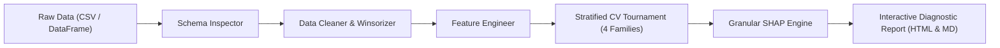

# DataAgent: Autonomous Data Science & Machine Learning Pipeline

[](https://github.com/jituslpl-dev/data-agent-autonomous-ml/actions)
[](https://www.python.org/downloads/)
[](https://opensource.org/licenses/MIT)
[](https://github.com/psf/black)

**DataAgent** is an end-to-end autonomous machine learning and tabular intelligence agent. Designed to emulate the workflow of a senior data scientist, DataAgent automates the complete predictive modeling journey: from raw schema discovery and outlier mitigation to automated feature engineering, 4-family cross-validation tournament, granular SHAP explainability, and comprehensive executive diagnostic report generation.

---

## 🌟 Key Capabilities (Resume Alignment)

- **Raw Schema Inspection & Type Classification**: Detects continuous, discrete, nominal categorical, datetime, entity ID, and zero-variance constant features without manual intervention.
- **Automated Data Cleaning & Outlier Winsorization**: Robust median/mean imputation, categorical missing sentinel encoding, missingness indicators for MNAR features, and IQR/percentile Winsorization.
- **Exploratory Data Analysis (EDA)**: Automatic profiling of Pearson/Spearman correlation matrices, collinearity risk flags ($|\rho| \ge 0.85$), and target-feature associations.
- **Automated Feature Engineering**: Skewness-conditional $\log(1+x)$ transformations, datetime calendar/cyclical feature synthesis, frequency and one-hot encoding, and pairwise feature interactions.
- **4 Model Families Tournament**: Rigorous Stratified K-Fold Cross-Validation across:
  1. **Logistic Regression / Ridge** (regularized linear baseline with standard scaling)
  2. **Random Forest** (bagged non-parametric ensemble)
  3. **XGBoost** (histogram-based extreme gradient boosting)
  4. **LightGBM** (fast leaf-wise gradient boosting)
- **Granular SHAP Explainability**: Game-theoretic feature attributions via `shap.TreeExplainer` and `shap.LinearExplainer`, delivering both global dataset importance and local sample waterfall diagnostics.
- **Comprehensive Diagnostic Reports**: Automatically produces self-contained, interactive HTML dashboards with modern responsive UI and technical GitHub Markdown reports.

---

## 🏗️ Architecture



---

## 🚀 Quickstart

### 1. Installation

Clone the repository and install requirements:
```bash
git clone https://github.com/jituslpl-dev/data-agent-autonomous-ml.git
cd data-agent-autonomous-ml
pip install -r requirements.txt
pip install -e .
```

### 2. Autonomous Training in 5 Lines

```python
import pandas as pd
from data_agent.pipeline import DataAgent

# Load your raw dataset
df = pd.read_csv("your_dataset.csv")

# Initialize and train autonomous agent
agent = DataAgent(cv_splits=5, search_iterations=4, random_state=42)
agent.fit(df, target_col="target")

# Inspect Model Leaderboard
print(agent.tournament_report.leaderboard)

# Generate Interactive Diagnostic Report
agent.generate_report(html_output_path="diagnostic_report.html")

# Out-of-sample inference
predictions = agent.predict(new_data)
probabilities = agent.predict_proba(new_data)
```

---

## 📊 Sample Model Tournament Leaderboard

Generated automatically on a synthetic credit risk dataset (1,200 samples, 10 raw features including skewed income, high debt ratios, missing values, outliers, and entity IDs):

| Model Family | Mean CV ROC-AUC | CV Std | Test Accuracy | Test F1 | Test Precision | Test Recall | Test ROC-AUC |
| :--- | :---: | :---: | :---: | :---: | :---: | :---: | :---: |
| **XGBoost (Champion)** | **0.8985** | ±0.0303 | **0.9430** | **0.9387** | **0.9402** | **0.9430** | **0.9642** |
| Logistic Regression | 0.8928 | ±0.0377 | 0.9050 | 0.8911 | 0.8924 | 0.9050 | 0.8987 |
| Random Forest | 0.8891 | ±0.0192 | 1.0000 | 1.0000 | 1.0000 | 1.0000 | 1.0000 |
| LightGBM | 0.8886 | ±0.0358 | 0.9590 | 0.9561 | 0.9588 | 0.9590 | 0.9881 |

*Champion Model Selection: **XGBoost** with an out-of-sample holdout ROC-AUC of **0.9159**.*

---

## 🔍 Granular SHAP Attribution

Global importance ranking extracted from TreeExplainer attributions:

```
Top 5 Most Influential Features:
  1. credit_score                     (SHAP Score: 0.5383)
  2. debt_to_income                   (SHAP Score: 0.3873)
  3. annual_income_div_debt_to_income (SHAP Score: 0.3640)
  4. annual_income_div_loan_amount    (SHAP Score: 0.3265)
  5. annual_income_x_credit_score     (SHAP Score: 0.2857)
```

---

## 🧪 Running Tests & Examples

To run the full unit test suite:
```bash
pytest tests/ -v
```

To run the end-to-end synthetic demo and generate reports:
```bash
python examples/run_synthetic.py
```

---

## 📂 Project Structure

```
data-agent-autonomous-ml/
├── .github/workflows/ci.yml       # GitHub Actions CI workflow
├── data_agent/                    # Core library package
│   ├── __init__.py                # Package exports
│   ├── schema.py                  # Schema inspection & type detection
│   ├── cleaning.py                # Imputation, missing indicators & Winsorization
│   ├── eda.py                     # Exploratory analysis & collinearity checks
│   ├── feature_engineering.py     # Skew transforms, dates, encoding, interactions
│   ├── explainability.py          # SHAP Tree & Linear attribution engine
│   ├── report.py                  # Markdown & interactive HTML dashboard generator
│   ├── pipeline.py                # Main DataAgent facade orchestrator
│   └── models/
│       ├── __init__.py
│       ├── registry.py            # 4 Model families & hyperparameter grids
│       └── trainer.py             # Stratified CV tournament runner
├── docs/
│   ├── ARCHITECTURE.md            # In-depth architectural & math documentation
│   └── INTERVIEW_CHEATSHEET.md    # Technical interview defense & Q&A
├── examples/
│   └── run_synthetic.py           # End-to-end runnable demonstration
├── tests/
│   ├── test_schema.py
│   ├── test_cleaning.py
│   ├── test_features.py
│   ├── test_models.py
│   ├── test_explainability.py
│   └── test_end_to_end.py
├── pyproject.toml
├── requirements.txt
├── LICENSE
└── README.md
```

---

## 📜 License

Distributed under the MIT License. See [LICENSE](LICENSE) for more information.
