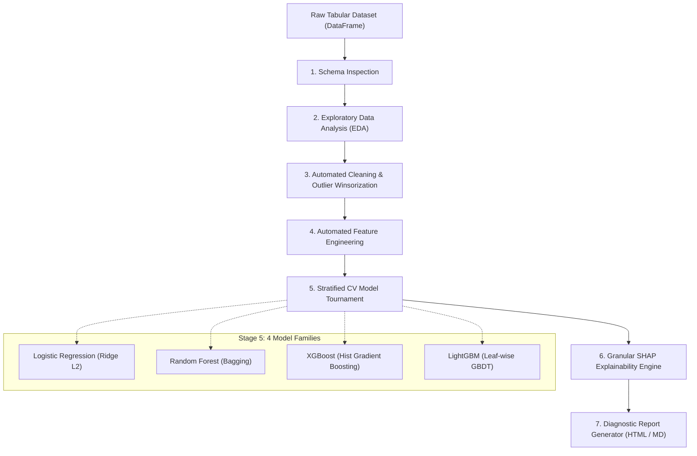

# DataAgent Architecture & Design Decisions

`DataAgent` is an autonomous tabular data science engine engineered to transform raw, noisy, heterogeneous tabular data into production-grade predictive models with statistical cross-validation and granular SHAP interpretability.

---

## 1. Pipeline Lifecycle

---

## 2. Component Breakdown

### Stage 1: Raw Schema Inspection (`data_agent/schema.py`)
- Automatically parses dtype representations, null counts, and cardinality distributions.
- Distinguishes continuous numerical features from discrete, low-cardinality numerical flags.
- Distinguishes nominal categoricals from high-cardinality entity IDs (e.g., UUIDs, serial tags) and constant features to eliminate uninformative columns upfront.
- Automatically determines problem formulation: `binary_classification`, `multiclass_classification`, or `regression`.

### Stage 2: Exploratory Data Analysis (`data_agent/eda.py`)
- Computes comprehensive descriptive statistics: quartiles, standard deviations, and kurtosis/skewness flags.
- Pearson & Spearman pairwise correlation analysis.
- Flags severe collinearity pairs ($|\rho| \ge 0.85$) to diagnose variance inflation risks.
- Computes direct feature-to-target correlations and class separability metrics.

### Stage 3: Automated Cleaning & Winsorization (`data_agent/cleaning.py`)
- Imputation:
  - Median imputation for skewed numerical variables.
  - Mean imputation for symmetric normal variables.
  - Mode imputation with a reserved `"MISSING"` sentinel class for categorical features.
- Missingness Indicators: Adds binary indicator flags `col_isna` for features with $>5\%$ missingness to retain MNAR (Missing Not At Random) signal.
- Outlier Winsorization: Clips extreme values beyond $[Q_1 - 3 \times \text{IQR}, Q_3 + 3 \times \text{IQR}]$ or 1st/99th percentiles to protect gradient descent and distance-based estimators.

### Stage 4: Feature Engineering (`data_agent/feature_engineering.py`)
- Skewness Normalization: Computes distribution skewness using `scipy.stats.skew` and applies $\log(1 + x)$ transformations to highly skewed positive features ($|\text{skew}| > 1.0$).
- Datetime Parsing: Automatically expands timestamp columns into cyclical/calendar components (year, month, day, dayofweek, is_weekend).
- Categorical Encoding:
  - One-Hot Encoding for low-cardinality nominal features ($\le 10$ unique categories).
  - Frequency / Target Count Encoding for medium/high-cardinality categories to avoid dimensional explosion.
- Multiplicative Interactions: Selects top correlated numerical features with the target and generates interaction cross-products $(X_i \times X_j)$.

### Stage 5: Stratified Cross-Validation Tournament (`data_agent/models/`)
- Evaluates **4 distinct model families**:
  1. **Logistic Regression / Ridge**: Calibrated linear baseline with $L_2$ regularization and standardized feature scaling.
  2. **Random Forest**: Non-parametric ensemble of decorrelated decision trees.
  3. **XGBoost**: Extreme gradient boosted trees with histogram-based split finding.
  4. **LightGBM**: Fast leaf-wise gradient boosting optimized for speed and categorical handling.
- Employs Stratified K-Fold CV (default 5 folds) to preserve class balance across all splits.
- Randomized Grid Search: Explores hyperparameters for each family over configurable iterations.
- Champion Selection: Selects the winning model based on out-of-fold generalization performance (ROC-AUC / F1 / RMSE).

### Stage 6: Granular SHAP Explainability Engine (`data_agent/explainability.py`)
- Automatically selects the optimal explainer:
  - `shap.TreeExplainer` for XGBoost, LightGBM, and Random Forest.
  - `shap.LinearExplainer` / Exact Explainer for regularized linear pipelines.
- Global Attribution: Computes mean absolute SHAP values:
  $$\text{Importance}_j = \frac{1}{N} \sum_{i=1}^N |\phi_i^{(j)}|$$
- Local Sample Attribution: Extracts top positive and negative feature contributions driving individual sample decisions.
- Automated Domain Insights: Flags leading predictive drivers and directional risk patterns.

### Stage 7: Comprehensive Diagnostic Reports (`data_agent/report.py`)
- Self-contained, responsive HTML executive dashboard with inline CSS styling, KPI metric cards, model comparison tables, and top SHAP drivers.
- Complete GitHub-flavored Markdown reports for CI/CD pipelines, technical handoffs, and audit trails.
